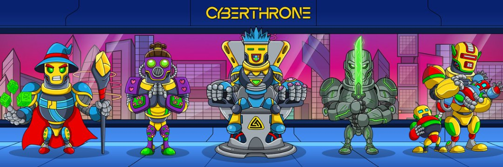

# ⚡ CYBERTHRONE: Neon Protocol

A cyberpunk-themed sliding puzzle web game featuring fluid hardware-accelerated tile transitions, procedural Web Audio synthesis, interactive particle effects, and authentic **CyberThrone** universe artwork.



## 🎮 Features

- **Fluid 60 FPS Sliding Animations**: Tiles translate smoothly using hardware-accelerated CSS 3D transforms (`translate3d(x, y, 0)`).
- **Multi-Tile Slide Support**: Clicking any tile aligned with the vacant slot slides all intervening tiles in one move.
- **Web Audio API Sound Engine**: Zero external audio dependencies—all sound effects (magnetic slides, snap chimes, reboot sweeps, victory fanfare, analog drone) are synthesized in real-time.
- **Authentic CyberThrone Blueprints**:
  - **CyberThrone King**: The signature robot monarch on the throne.
  - **Golden Knight**: Armored cybernetic commander with crown and cross staff.
  - **Neon City Duel**: Cyclops gunner vs. purple spear operative under the glowing emblem.
  - **CyberThrone Emblem**: Iconic impossible-triangle crest with cyan-to-magenta neon gradient.
  - **Cyber Pantheon**: Full squad lineup.
- **Custom Image Upload**: Drag-and-drop or select any image to automatically slice it into a playable puzzle matrix.
- **Multiple Difficulty Grids**: 3×3 (Novice Grid), 4×4 (Cyber Matrix), 5×5 (Neural Overlord).
- **Guaranteed Solvability**: Shuffled using reverse valid matrix walks.
- **Controls**: Mouse, Touch Swipe gestures, Keyboard (`WASD` & Arrow Keys), `H` for AI hint, `P` for blueprint inspection.
- **Local Records & Ranking**: Tracks best times and moves in LocalStorage with rank evaluations (SSS, S, A, B).

## 🚀 Quick Start

Simply open `index.html` in any modern web browser or serve locally using any static web server:

```bash
# Python
python -m http.server 8080

# Node.js
npx http-server -p 8080
```

Then visit `http://localhost:8080` in your browser.

## 🛠️ Tech Stack

- **HTML5**: Semantic layout & responsive markup
- **Vanilla CSS**: Custom properties, neon glow styling, scanlines, glassmorphism
- **JavaScript (ES6+)**: Puzzle matrix math, Web Audio oscillators, canvas particles, input handling

## 📄 License

MIT License. CyberThrone artwork copyright of respective creators.
